# MONAN-grid-generator — user guide

MONAN-grid-generator makes horizontal meshes for MONAN (and MPAS-Atmosphere): fine cells where you need detail, coarser cells elsewhere, and, if you want a regional model, a domain cut out of the globe with the boundary layers MPAS expects. You describe the mesh with a handful of numbers; the tool does the mesh generation, checks the result and gives you a plot and a report to confirm it.

**Contents**

1. [Key ideas in two minutes](#1-key-ideas-in-two-minutes)
2. [Setting up](#2-setting-up)
3. [Tutorial: from an idea to a checked mesh](#3-tutorial-from-an-idea-to-a-checked-mesh)
4. [Reading the report](#4-reading-the-report)
5. [Using the mesh in MONAN](#5-using-the-mesh-in-monan)
6. [Reference: every input key](#6-reference-every-input-key)
7. [Choosing good values](#7-choosing-good-values)
8. [Troubleshooting](#8-troubleshooting)
9. [Frequently asked questions](#9-frequently-asked-questions)
10. [Further reading](#10-further-reading)

---

## 1. Key ideas in two minutes

A mesh is described by **two choices**:

| | `cut=global` (no cut) | `cut=circle` | `cut=ellipse` |
|---|---|---|---|
| **`refinement=uniform`** — same cell size everywhere | uniform globe | uniform circular domain | uniform elliptical domain |
| **`refinement=circle`** — fine cells in a circle | fine circle on the globe | circular domain | circle in an elliptical domain |
| **`refinement=ellipse`** — fine cells in an ellipse | fine ellipse on the globe | ellipse in a circular domain | elliptical domain |

- **Cell size** is in kilometres: the distance between the centres of neighbouring cells. `high_res` is the fine size, `low_res` the coarse size.
- **The transition** is where cells grow from `high_res` to `low_res`. Cells grow linearly with distance across it.
- **The cut** (for a regional mesh) is the edge of your domain. Beyond it the tool adds **7 rows of boundary cells** (MPAS's 5 *relaxation* + 2 *specified* layers), all at one constant size, where the model receives its lateral boundary conditions.
- **The cut must lie outside the transition.** Then all boundary cells have the same size. The tool refuses a cut that crosses the transition and tells you the minimum size.

```
 circle refinement, circle cut (seen from above, radius in km)

   centre ──── high_res ────┐ inner_radius
                            └── cells grow ──┐ outer_radius = cut (default)
                                             └── 7 boundary layers at low_res
```

Every run produces, in `grids/<mesh name>/`:

| File | What it is |
|---|---|
| `<name>.grid.nc` | the mesh, for MONAN/MPAS |
| `<name>.graph.info` | the cell-neighbour graph |
| `<name>.graph.info.part.N` | how the cells are split over N MPI tasks (when N > 1) |
| `<name>.png` | a map of the mesh |
| `<name>.report.html` | the report: checks, drawings and distributions |
| `<name>_for_plotting.grid.nc` | the same mesh with the generation parameters stored as attributes |
| your input file | a copy, so you always know how the mesh was made |

---

## 2. Setting up

You need the conda environment **`monan-grid`** (it contains JIGSAW, MPAS-Tools, METIS/gpmetis, plotting libraries and pytest). Create it once, from the repository folder:

```bash
conda env create -f sources/CGFD-USP-Create-Mesh/envs/monan_grid_env.yml
```

This works on a Mac (Intel or Apple Silicon) and on Linux, including the cluster. You don't need to activate it before running `create_mesh.bash` — the script does that — but you do for the tests and for your own Python work:

```bash
conda activate monan-grid
pytest tests/ -v          # optional: 33 tests, about 2–3 minutes
```

The web page needs nothing installed: it is a single file, `tools/mesh_input_designer.html`, that opens in any browser. Its map needs an internet connection; everything else works offline.

---

## 3. Tutorial: from an idea to a checked mesh

**Goal:** a regional mesh with **20 km** cells over Southeast Brazil (a circle of 300 km radius around 22.9°S, 45.0°W), growing to **60 km** at 600 km, cut there, and split over **4** MPI tasks. These coarse sizes build in about 10 seconds on a laptop; at the end we see how to scale up.

You can design the input file in two ways: with the web page (step 2a) or by writing it yourself (step 2b). Both give the same file.

### Step 1 — Decide what you need

Answer four questions before touching anything:

1. **Where must the model be fine?** Here: Southeast Brazil → a circle of 300 km around 22.9°S, 45.0°W.
2. **How fine, and how coarse elsewhere?** 20 km inside, 60 km outside.
3. **Regional or global?** Regional → we need a cut. Default: cut where the transition ends (600 km).
4. **How many MPI tasks will run the model?** 4.

### Step 2a — Design it on the web page

1. Open the page: `open tools/mesh_input_designer.html` (or double-click it in Finder).
2. Under **Refinement**, click **Circle**.
3. Place the centre: **click on the map** over Southeast Brazil, or type `-22.9` and `-45` in *Centre latitude* and *Centre longitude*. The dark dot is the centre; drag it to move everything.
4. Size the circle: drag the **dark-green dot** (the fine circle) to about 300 km and the **light-green dot** (where the transition ends) to about 600 km — or type `300` and `600` in *Fine circle radius* and *Transition ends at*. The shapes and numbers follow each other.
5. Type the cell sizes: *Inside cell size* `20`, *Outside cell size* `60`.
6. Under **Cut**, click **Circle** and leave **“Cut where the transition ends (default)”** ticked. The orange line is the cut; the grey dotted line shows where the boundary layers end.
7. Set *MPI partitions* to `4`. Leave *Boundary layers* at `8` (see [n_layers](#6-reference-every-input-key)).
8. Read the **messages** under the inputs: a green ✓ means the inputs follow the generator's rules. A red message explains what to change (for example a cut that crosses the transition, with the minimum size).
9. Look at the **Estimate** tiles: about 2,200 cells, a model time step of about 120 s, and the memory needed while generating.
10. Click **Download** (or **Copy** and paste into a new file). Save it as `my_mesh.txt` next to the repository's `scripts/` folder, or anywhere you like.

> Ellipse refinement works the same way, with three dots instead of two: one sets the semi-axis **a** and the rotation, one the semi-axis **b**, and the light-green one the transition width (**delta**). To cut a domain of a different size than the default, untick the default box and drag the **orange** dots.

### Step 2b — Or write the input file yourself

The file is plain text: one `key=value` per line, `#` starts a comment. You only need the keys of your option. For the tutorial:

```text
# Tutorial mesh: 20 km over Southeast Brazil, 60 km around it
lat=-22.9
lon=-45.0
refinement=circle
high_res=20
low_res=60
inner_radius=300
outer_radius=600
cut=circle
N=4
```

`scripts/mesh_input_file.txt` is the reference: it lists **every** key with an explanation; copy it and keep what you need. The full list is in [section 6](#6-reference-every-input-key).

### Step 3 — Build the mesh

From the repository folder (or anywhere — the script finds its way):

```bash
bash scripts/create_mesh.bash my_mesh.txt
```

The run prints its progress. The important part is the list of checks near the end; for the tutorial it looks like this (paths shortened):

```text
Mesh name: lat_-22.9_lon_-45_circle_ir_300_or_600_hres_20_lres_60_cut_circle_r_600.region
>> Creating a variable resolution map
>> Generating a MPAS mesh
>> Cutting a circle region centered at (-22.9, -45) with 8 layers
>> Checking the mesh
  [OK  ] finite values: all floating-point fields are finite
  [OK  ] points on the sphere: max | |x|/R - 1 | = 2.22e-16
  [OK  ] lat/lon match x,y,z: max angle mismatch 1.13e-15 rad
  [OK  ] connectivity: cells, edges and vertices reference each other consistently
  [OK  ] topology (V - E + F): V - E + F = 1, expected 1 for a single region without holes
  [OK  ] positive lengths and areas: dcEdge, dvEdge, areaCell, areaTriangle > 0
  [OK  ] dvEdge/dcEdge: min dvEdge/dcEdge = 0.199 (heuristic limit 0.12)
  [OK  ] Voronoi property: vertices are circumcentres, edges orthogonal, dcEdge/dvEdge exact
  [OK  ] areas: kite, cell, triangle and total areas are consistent
  [OK  ] near-centroidal cells: max |centroid - generator| / sqrt(area) = 0.095 (limit 0.15)
  [OK  ] smooth grading: max size ratio of neighbouring cells = 1.335 (limit 1.5)
  [OK  ] boundary layers: 7 complete, nested boundary layers
  [OK  ] graph.info: matches the mesh connectivity
  [OK  ] cell size follows the requested map: median size/target = 0.995, 100.0% of cells within ±25% (need ≥95%)
  [OK  ] boundary layers at uniform resolution: all 674 boundary-layer cells within the 60 km ring ...
  [OK  ] cut region kept: interior 1.246e+06 km² for a cut of 1.13e+06 km²
  [OK  ] partition file: 4 partitions covering all cells
>> Plotting the mesh and writing its report
Mesh plot: grids/lat_-22.9_..._r_600.region/lat_-22.9_..._r_600.region.png
Report:    grids/lat_-22.9_..._r_600.region/lat_-22.9_..._r_600.region.report.html
Done. Mesh files in grids/lat_-22.9_lon_-45_circle_ir_300_or_600_hres_20_lres_60_cut_circle_r_600.region
```

- `[OK  ]` passed, `[WARN]` is worth a look (the mesh is still delivered), `[FAIL]` stops the run: the mesh is **not** partitioned or delivered, and the report is written to the work folder printed on screen so you can see why.
- The **mesh name** is built from your values, so different meshes never overwrite each other. The script also writes it into your input file as `file_name=…` (replacing any older line).
- Running the same file again does nothing (“Mesh already exists”); add `--overwrite` to rebuild.

### Step 4 — Look at the mesh plot

Open `<name>.png` (in Finder, VS Code, or any image viewer):

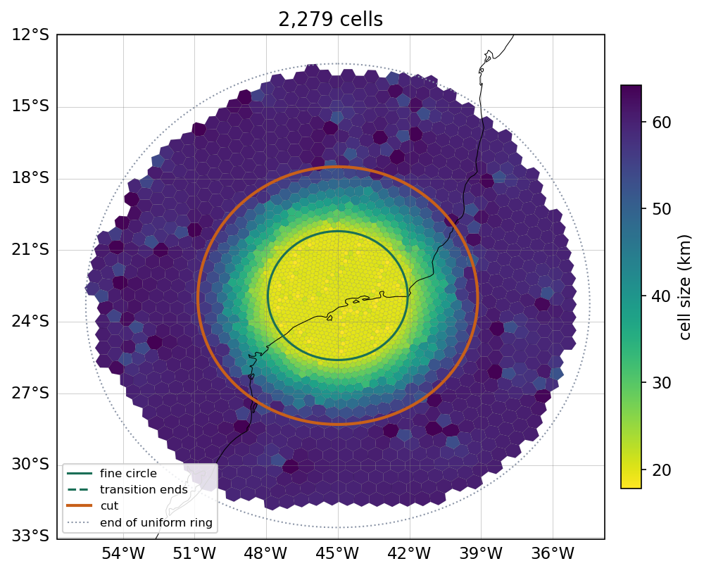

What to check, in this order:

1. **The fine area is where you wanted it**: yellow (20 km) cells fill the green circle around the centre.
2. **The colours go smoothly from yellow to purple** across the transition — no isolated jumps.
3. **The orange cut line** is where the transition ends (here it hides the dashed “transition ends” line, because the default cut sits exactly on it).
4. **Beyond the cut**, a band of uniform purple (60 km) cells: the 7 boundary layers. They end inside the grey dotted line.
5. **The number of cells** in the title (2,279 here) is in the range you expected (the web page estimated ~2,200).

### Step 5 — Open the report

Open `<name>.report.html` in a browser. It is one self-contained file (you can e-mail it). Section 4 walks through it.

### Step 6 — Scale up to the real resolution

When the coarse version looks right, change only the cell sizes, e.g. `high_res=3` and `low_res=15`, and run again. Before you do:

- Check the **Estimate** on the web page: cells grow roughly with 1/high_res² inside the fine area, and so does generation time. Memory is driven by the generator's global size map: about 0.7 GB per array at 3 km and 2.8 GB at 1.5 km, with several such arrays in memory at once — run fine meshes on the cluster.
- Keep the **transition** reasonable: going from 3 to 15 km over 300 km is gentle; see [section 7](#7-choosing-good-values).

---

## 4. Reading the report

The report has six parts. For each: what it shows, what “good” looks like, and what should make you look closer.

### 4.1 Status and summary

A badge at the top: **green** “all N checks passed”, **orange** “… warning(s)”, or **red** “… check(s) failed”. Below it: cells, edges, vertices, the cell-size range and how long each step took; then the input parameters and the file names.

### 4.2 The mesh

The same map as `<name>.png` (for a global mesh: the whole globe plus a zoom on the refinement), and a second map, **where the cell size departs from the request**:

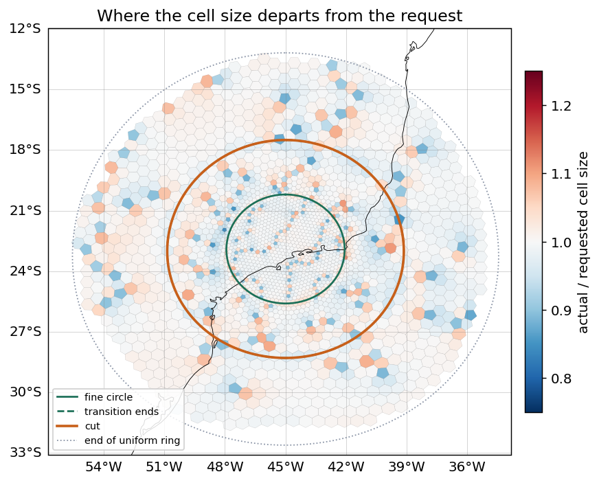

- **Good:** mostly white (actual ≈ requested), with scattered light red/blue cells.
- Scattered single cells of ±10–15% are normal: they are the pentagons and heptagons that let the mesh change size.
- **Look closer** if whole regions are red or blue, or if a band of strong colour follows the transition: the mesh is not following the request there.

### 4.3 Checks

A table with every check: its group, result, the measured value, what it tests, why it matters and the references. The checks fall in three groups:

| Group | What it protects | Examples |
|---|---|---|
| **MPAS structure** | properties the MPAS equations are written for | cells are true Voronoi cells, edges are orthogonal to the line between cell centres, areas add up, connectivity is in MPAS order |
| **Limited area** | what a regional MPAS run needs | 7 nested boundary layers, graph and partition files |
| **Generator** | that the mesh is the one you asked for | cell size follows the request, boundary layers sit in uniform cells, the whole domain is kept |

A **FAIL** means the mesh must not be used. A **WARN** means the mesh is valid but deviates from what is expected — look at the matching distribution (4.5). Some limits are heuristics, not MPAS rules, and the report says so: dvEdge/dcEdge ≥ 0.12, centroid offset ≤ 0.15 and neighbour size ratio ≤ 1.5.

### 4.4 What the checks test

Drawings that explain the checks, so you don't need to know the MPAS file format:

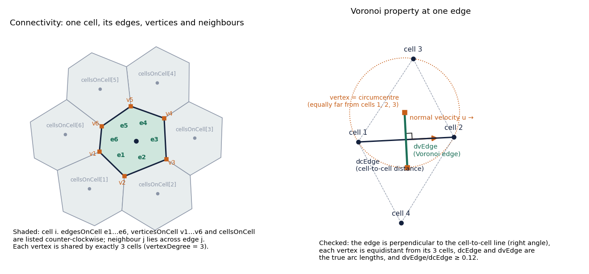

*Left:* how each cell lists its edges, vertices and neighbours (counter-clockwise, neighbour *j* across edge *j*; 3 cells meet at each vertex). *Right:* at each edge, the Voronoi edge (dvEdge) is perpendicular to the line joining the two cell centres (dcEdge), and each vertex is equally far from its three cells. The MPAS C-grid needs exactly this.

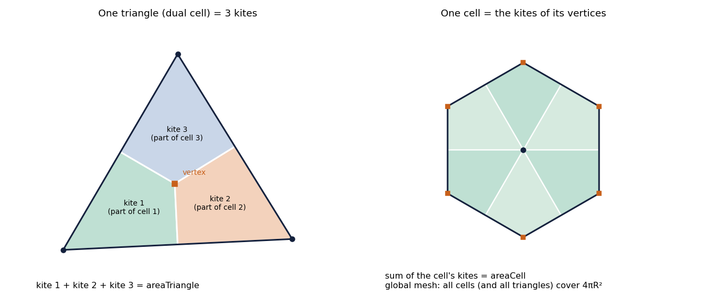

Each triangle around a vertex is split into three “kites”, one per cell; they must add up to the triangle and to each cell. MPAS uses them to move quantities between cells and vertices.

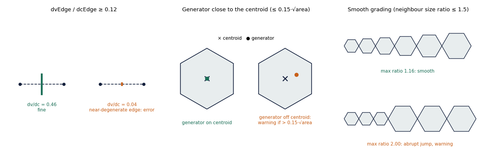

The three quality checks: a near-degenerate edge (error), a cell whose generator is far from its centre (warning), an abrupt jump in cell size between neighbours (warning).

For a regional mesh, the last drawing is **this mesh's own boundary layers**:

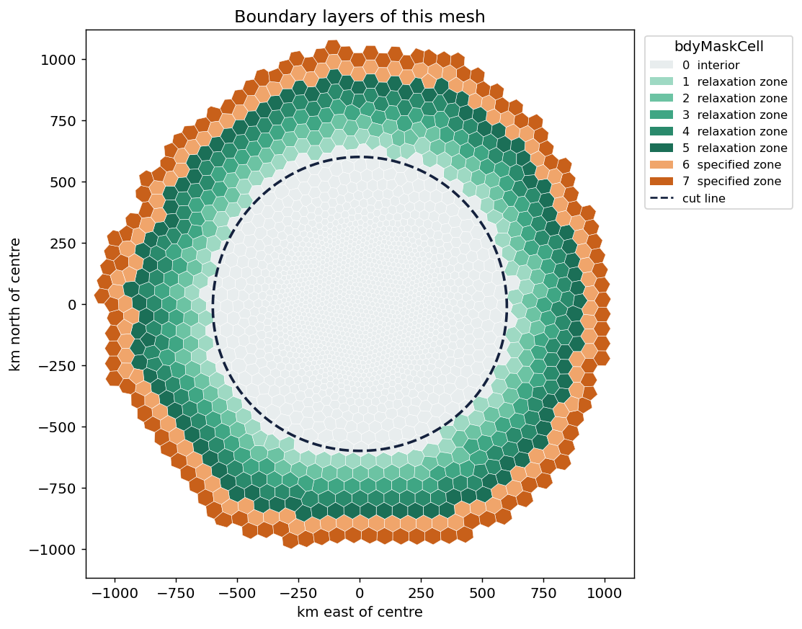

- **Good:** grey interior inside the dashed cut line, then five green layers (relaxation zone) and two orange layers (specified zone), each one cell thick and closed all the way round.
- **Look closer** if a layer has gaps or the colours mix — the *boundary layers* check would also fail.

### 4.5 Distributions

Histograms that let you see what is in the mesh.

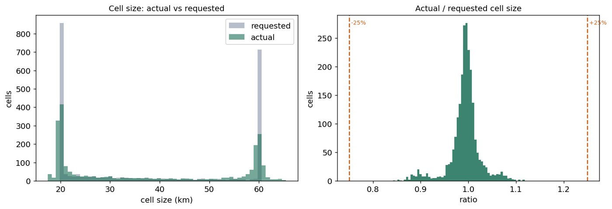

*Cell size: actual vs requested* — the two histograms should overlap: here peaks at 20 km (the fine circle) and 60 km (outside), with the transition in between. *Actual / requested* — a narrow peak at 1, well inside the dashed ±25% lines.

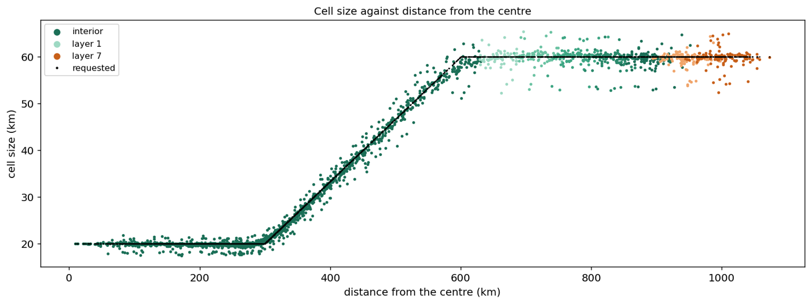

*Cell size against distance from the centre* — each dot is a cell, black dots are the requested size. You should see flat at 20 km out to 300 km, a straight rise to 60 km at 600 km, then flat again; the coloured dots (boundary layers) all at 60 km. For an ellipse the rise is a band, because distance from the centre is not the ellipse's own coordinate.

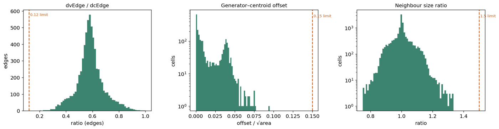

*dvEdge/dcEdge* — everything should be to the right of the 0.12 line (for hexagons the typical value is about 0.58). *Generator–centroid offset* and *neighbour size ratio* — the bulk well left of their dashed limits. A long tail towards the limit usually comes from a steep transition.

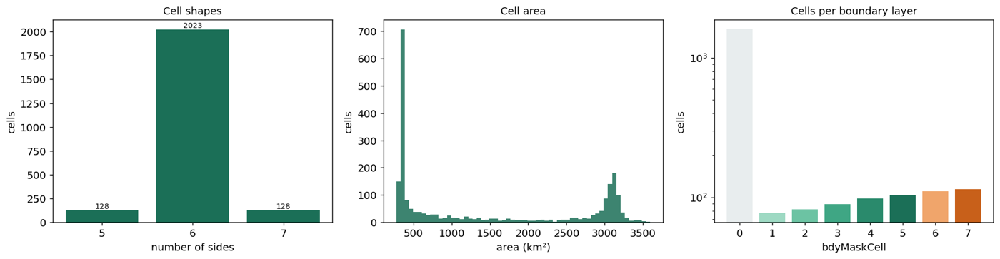

*Cell shapes* — almost all hexagons, a few pentagons and heptagons (normal where resolution changes). *Cell area* — two groups, fine and coarse cells. *Cells per boundary layer* — rising slightly outwards, all present.

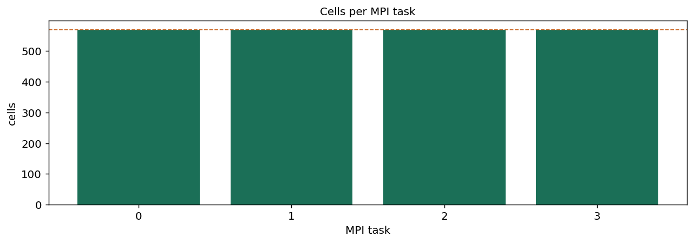

*Cells per MPI task* — bars of similar height; the caption gives largest/mean (1.00 = perfectly balanced).

### 4.6 References

The papers and documents behind each check, to read in full when you need to.

---

## 5. Using the mesh in MONAN

1. Copy `<name>.grid.nc` and `<name>.graph.info.part.N` into the MONAN run (or pre-processing) folder.
2. Use `<name>.grid.nc` as the grid file of the MONAN/MPAS pre-processing (static fields and initial conditions) — see the MONAN and MPAS-Atmosphere documentation for those steps.
3. Run the model with **N MPI tasks**, the same N as the partition file.
4. Need another number of tasks? Partition again without rebuilding the mesh (in the `monan-grid` env):
   ```bash
   gpmetis -minconn -contig -niter=200 <name>.graph.info 128
   ```
5. A model time step to start from: about **6 seconds per km of the smallest cell** (a rule of thumb; the web page shows it). Check against the MPAS-Atmosphere user's guide and reduce it if the model is unstable.

---

## 6. Reference: every input key

Lengths in km, angles in degrees. “Required” depends on your choice of refinement and cut; keys you give but your option doesn't use are reported and ignored; misspelt keys trigger a warning.

| Key | Meaning | Used by | Default |
|---|---|---|---|
| `lat`, `lon` | centre of the refinement and of the cut | always | — (required) |
| `refinement` | `uniform`, `circle` or `ellipse` | always | — (required) |
| `cut` | `global`, `circle` or `ellipse` | always | — (required) |
| `high_res` | finest cell size (uniform: the only size) | always | — (required) |
| `low_res` | cell size outside the refinement; must be larger than `high_res` | circle, ellipse | — (required) |
| `inner_radius` | radius of the fine circle | refinement=circle | — (required) |
| `outer_radius` | radius where the transition ends | refinement=circle | — (required) |
| `a_km`, `b_km` | ellipse semi-axes (along the rotated x and y directions) | refinement=ellipse | — (required) |
| `angle` | ellipse rotation, counter-clockwise from east | refinement=ellipse | 0 |
| `delta` | transition width as a fraction of the ellipse size (transition ends at the ellipse scaled by 1 + delta) | refinement=ellipse | 0.12 |
| `cut_radius` | radius of a circular domain | cut=circle | `outer_radius` for a circle refinement; required otherwise |
| `cut_a_km`, `cut_b_km` | semi-axes of an elliptical domain | cut=ellipse | (1 + delta)·a, (1 + delta)·b for an ellipse refinement; required otherwise |
| `cut_angle` | rotation of an elliptical domain | cut=ellipse | `angle` for an ellipse refinement, else 0 |
| `n_layers` | boundary layers passed to MPAS-Limited-Area; `n_layers = N` gives N − 1 layers and MPAS needs 7 | regional cuts | 8 (keep it) |
| `N` | number of MPI partitions; 1 = no partition file | always | 1 |
| `make_report` | `yes`: write the mesh plot and report; `no`: skip them | always | yes |
| `meshes_dir` | where meshes are written | optional | `<repo>/grids` |
| `file_name` | written by the tool after each run (the last mesh made) | automatic | — |

Command-line options of `create_regional_mesh.py` (called by `create_mesh.bash`): `--overwrite` rebuild an existing mesh, `--no_report` skip plot and report, `--keep_work_dir` keep the intermediate files, `--help` the full list.

**Removed keys:** `grid_type` and `do_regional` are no longer used. A file that still has them stops with the equivalent new settings, e.g. `grid_type=doughnut, do_regional=y` → `refinement=circle, cut=circle`.

**Output names:** the mesh folder name lists the exact values, e.g. `lat_-22.9_lon_-45_circle_ir_300_or_600_hres_20_lres_60_cut_circle_r_600.region` (ir/or = inner/outer radius, hres/lres = high/low res, r = cut radius; ellipse: a, b, ang, delta).

---

## 7. Choosing good values

- **Make the fine area larger than your region of interest.** Weather systems enter from outside; give them room to be resolved before they reach you.
- **Transition width.** A gentle transition keeps the mesh smooth. A useful number is the growth of cell size per km of distance: (low_res − high_res) / (outer_radius − inner_radius). The tutorial has 40/300 ≈ 0.13 km/km. The web page warns above 0.25 km/km. Steeper meshes are still valid and MPAS will run on them (see [FAQ](#9-frequently-asked-questions)), but check the model fields near the transition.
- **Domain size.** Larger regional domains generally give smaller errors from the lateral boundaries (Skamarock et al. 2018). Keep the cut well away from the area you care about.
- **Boundary layers.** Keep `n_layers=8` (7 layers). The tool puts them in uniform cells automatically.
- **Partitions.** Choose `N` = the number of MPI tasks you will run; you can add more later with `gpmetis` (section 5).
- **Cost.** Cells, generation time and memory all grow quickly as `high_res` shrinks; use the web page's estimate and start coarse.

---

## 8. Troubleshooting

| You see | Meaning | What to do |
|---|---|---|
| `ERROR: missing inputs for refinement=circle, cut=circle:` followed by a list | required keys are missing; each is listed with its meaning | add them (section 6) |
| `ERROR: grid_type and do_regional are no longer used. … use: refinement=circle, cut=circle …` | an old input file | replace the two keys as suggested |
| `ERROR: the cut passes through the refinement or its transition zone … use cut_radius >= 600 km` | the domain edge crosses the transition | use at least the size given (or the default cut) |
| `ERROR: n_layers must be an integer >= 8 …` | too few boundary layers | use `n_layers=8` |
| `ERROR: high_res must be smaller than low_res` | sizes swapped | swap them |
| `WARNING: unknown key 'hihg_res' … (typo?) - ignored.` | a misspelt key | fix the spelling |
| `Note: not used for refinement=uniform, cut=global: inner_radius` | a key your option doesn't use | nothing to do (or remove it) |
| `Mesh already exists … (use --overwrite to regenerate)` | same inputs as an earlier run | nothing to do, or add `--overwrite` |
| `[FAIL] …` then `the mesh failed the checks above` | the mesh broke an MPAS rule | open the report in the printed work folder; usually a much too steep transition — widen it |
| `[WARN] smooth grading …` | steep size change between neighbours | valid mesh; consider a wider transition |
| `WARNING: the mesh plot/report could not be made …` | plotting failed (the mesh is fine) | read the message; on machines without internet, coastlines may be missing — the report says so |
| `conda: command not found` / `EnvironmentNameNotFound: monan-grid` | conda or the env is not available | load conda (on the cluster: its module) and create the env (section 2) |
| `gpmetis not found` | wrong environment | activate `monan-grid` |
| the run stops during “Creating a variable resolution map” with a memory error | the size map is too large for the machine | run on the cluster, or start with a coarser `high_res` |

If something else goes wrong, keep the intermediate files with `--keep_work_dir` and look at the printed messages; run `pytest tests/ -v` to check your installation.

---

## 9. Frequently asked questions

**Does MPAS require a smooth transition?** No. The MPAS equations are written for any Voronoi mesh, however abruptly the cell size changes. Smooth transitions are recommended for accuracy: where cells change size quickly the numerics are locally less accurate, waves can be partly reflected, and scale-dependent physics (convection, diffusion) changes abruptly. Steep meshes run and can give good results, especially if the area you study is well inside the fine region — but look at the fields near the transition.

**Can the refinement or the domain be a square?** MPAS itself has no restriction on shape, and MPAS-Limited-Area can cut any polygon. This tool currently offers circles and ellipses.

**Global or regional?** A global variable-resolution mesh needs no lateral boundary conditions but costs more cells; a regional mesh is cheaper but depends on its boundary conditions. Both are supported with the same inputs (`cut=global` vs `cut=circle`/`ellipse`).

**Why does the number of cells in the report differ slightly from the web page?** The page estimates from areas; the real mesh rounds to whole cells and adds pentagons and heptagons. Expect a few percent.

**Where are my old meshes?** In `grids/` (or your `meshes_dir`), one folder per mesh, named after its values.

---

## 10. Further reading

- Skamarock et al. (2012), *Mon. Wea. Rev.* 140, 3090–3105 — MPAS-Atmosphere on centroidal Voronoi meshes. doi:10.1175/MWR-D-11-00215.1
- Skamarock, Duda, Ha & Park (2018), *Mon. Wea. Rev.* 146, 3445–3460 — regional (limited-area) MPAS. doi:10.1175/MWR-D-18-0155.1
- Ringler et al. (2010), *J. Comput. Phys.* 229, 3065–3090; Thuburn et al. (2009), *J. Comput. Phys.* 228, 8321–8335 — the C-grid scheme MPAS uses.
- Ringler et al. (2011), *Mon. Wea. Rev.* 139, 3348–3368 — variable-resolution meshes and transitions. doi:10.1175/MWR-D-10-05049.1
- MPAS Mesh Specification — https://www2.mmm.ucar.edu/projects/mpas/mpas_website_linked_files/mpas_meshspec.pdf
- Engwirda (2017), *Geosci. Model Dev.* 10, 2117–2140 — JIGSAW, the mesh generator used here. doi:10.5194/gmd-10-2117-2017
- Each mesh report lists the references behind every check.
